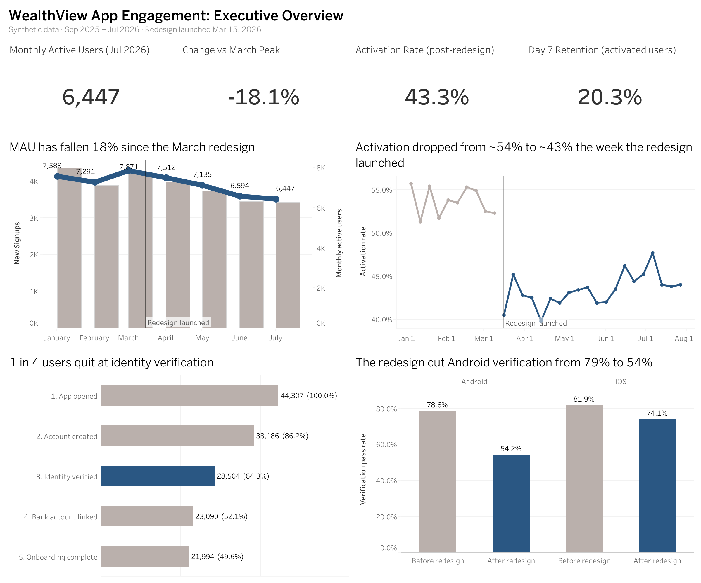
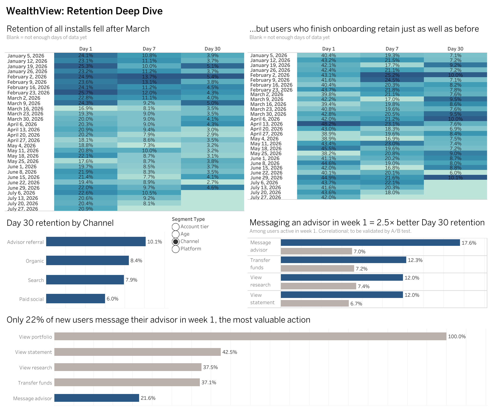

# WealthView: Diagnosing an App Decline (User Retention & Product Analytics)

**The question:** WealthView, a (fictional) wealth-management mobile app, saw monthly active users fall **18%** between March and July 2026. Leadership wants to know why, and what the product team should fix first.

**The answer:** A redesigned onboarding flow broke identity verification on Android. Activation fell from ~54% to ~43%, while users who *did* get through retained as well as ever. I recommend simplifying verification (validated with an A/B test: **+4 pts** onboarding completion overall, **+8 pts on Android**), rolled out in stages with fraud monitoring, then testing a week-1 advisor messaging nudge.

**Tools:** SQL (SQLite) · Python (pandas, numpy) · Tableau

| | |
|---|---|
| 📊 **Interactive dashboard** | [Tableau Public](https://public.tableau.com/views/WealthViewAppRetention/ExecutiveOverview) |
| 🗂️ **Presentation** | [docs/presentation.pdf](docs/presentation.pdf) |
| 🧪 **A/B test proposal** | [docs/ab_test_proposal.md](docs/ab_test_proposal.md) |
| 📋 **Prioritized improvements (RICE)** | [docs/rice_prioritization.md](docs/rice_prioritization.md) |

---

## Dashboard





---

## Key findings

| # | Finding | Evidence |
|---|---------|----------|
| 1 | **MAU is down 18%** from its March peak (7,871 → 6,447) | `sql/07_active_users_trend.sql` |
| 2 | **Identity verification is the biggest leak** in onboarding: 9,682 users (25% of account creators) quit there | `sql/03_onboarding_funnel.sql` |
| 3 | **The March 15 redesign broke Android verification**: 79% → 54% pass rate (iOS: 82% → 74%) | `sql/04_funnel_by_redesign_and_platform.sql` |
| 4 | **Post-onboarding engagement didn't change**: Day 30 retention of activated users is ~8% before and after. The problem is getting in, not staying | `sql/05_retention_cohorts.sql` |
| 5 | **Messaging an advisor in week 1 is the "aha moment"**: 17.6% vs 7.0% D30 retention (2.5×), vs ~1.7× for other features, among equally active users. Yet only 22% of new users do it | `sql/08`, `sql/09` |
| 6 | **Paid social brings the weakest users** (6.0% D30 vs 10.1% for advisor referrals) | `sql/06_retention_by_segment.sql` |

## Recommendation

1. **Ship the simplified verification flow in stages:** all Android users and half of iOS first, with weekly fraud monitoring, then full rollout. Expected: ~420 more activated users per quarter.
2. **A/B test a week-1 advisor messaging nudge** to check whether the link with retention is causal.
3. **Shift acquisition spend** from paid social toward advisor referrals.

---

## Project structure

```
app-retention-analysis/
├── data/
│   └── generate_data.py        # creates users.csv + events.csv (synthetic, seeded)
├── sql/
│   ├── 01_data_quality_checks.sql
│   ├── 02_clean_data.sql       # removes duplicates + test accounts
│   ├── 03_onboarding_funnel.sql
│   ├── 04_funnel_by_redesign_and_platform.sql
│   ├── 05_retention_cohorts.sql   # D1 / D7 / D30 by weekly cohort
│   ├── 06_retention_by_segment.sql
│   ├── 07_active_users_trend.sql  # MAU, DAU, stickiness
│   ├── 08_feature_adoption.sql
│   └── 09_aha_moment.sql
├── run_analysis.py             # loads data into SQLite, runs all SQL, exports CSVs
├── outputs/                    # query results (dashboard data source)
├── ab_test/
│   └── ab_test_analysis.py     # sample size, simulated test, z-test, guardrails
├── dashboard/                  # screenshots + Tableau data workbook
└── docs/                       # RICE table, A/B test proposal, presentation
```

## How to run it

Requires Python 3.9+ with pandas and numpy (`pip install -r requirements.txt`). SQLite is built into Python, so there's no database to install.

```bash
python data/generate_data.py      # ~15 seconds → data/users.csv, data/events.csv
python run_analysis.py            # ~10 seconds → wealthview.db + outputs/*.csv
python ab_test/ab_test_analysis.py
```

The raw data and database aren't stored in this repo (they're large); the first two commands recreate them exactly.

## Data & methodology notes

- **Data is synthetic**, generated to mimic a real event-tracking export (≈44K users, ≈720K events, Sep 2025 – Jul 2026). It deliberately includes duplicate events, internal test accounts and missing values, which are found and cleaned in `sql/01` and `sql/02`.
- **Retention definition:** Day-N retention = active on exactly calendar day signup + N. Users without N full days of data are excluded from that metric.
- **Confounding check:** comparing all users, *every* feature looks like it doubles retention, because engaged people do more of everything. Restricting to users active in week 1 isolates advisor messaging as the real outlier. It's still correlational, which is why the recommendation is an experiment, not a launch.
- **A/B test results are simulated** to demonstrate the analysis (sample size, significance testing, guardrails, decision rules).
